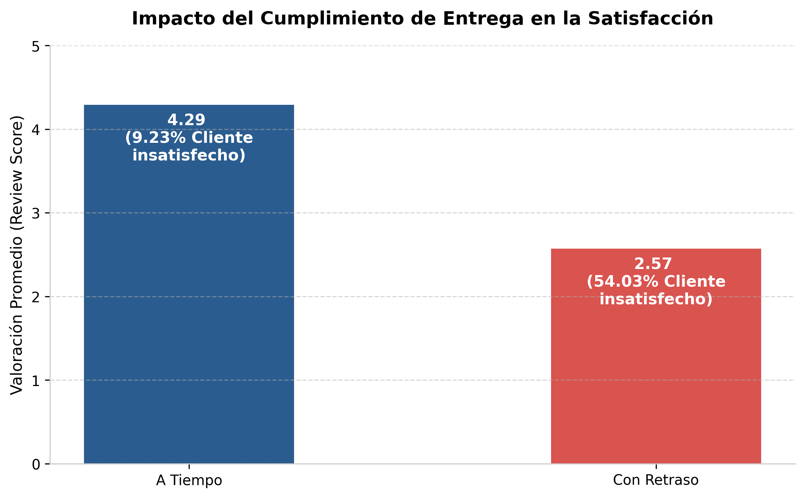
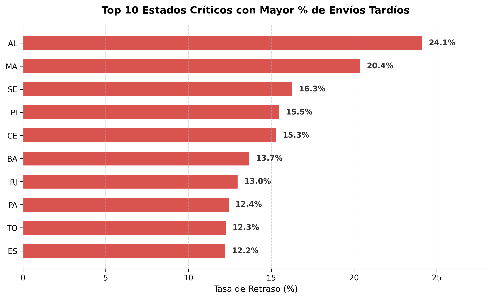
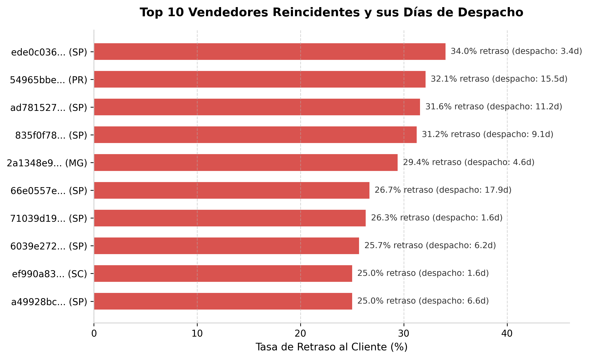
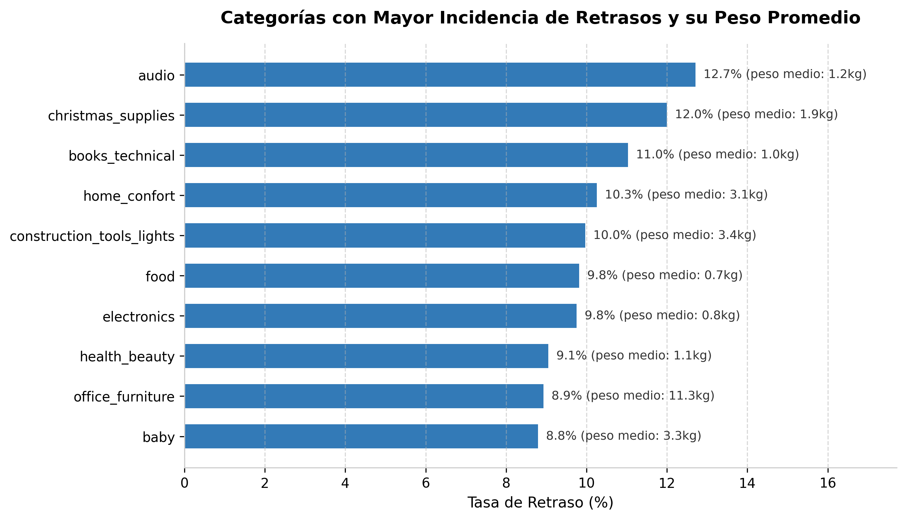
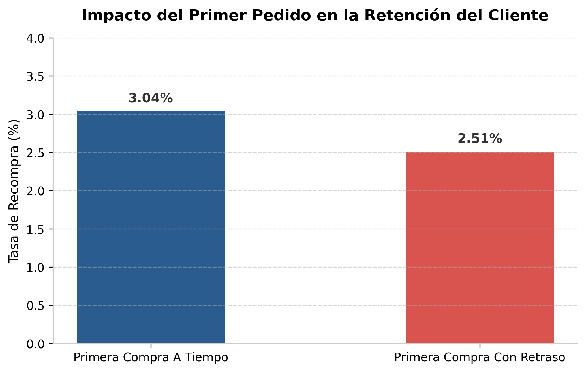

# Olist Logistics & Customer Retention Analysis

[](https://www.python.org/)
[](https://duckdb.org/)
[](https://matplotlib.org/)

## Descripción

Este proyecto consiste en el análisis de más de 100.000 pedidos del marketplace brasileño Olist, con el objetivo de identificar cuellos de botella en la cadena logística y cuantificar cómo los fallos de entrega impactan directamente en la satisfacción y la retención del cliente.

A diferencia de un análisis logístico tradicional centrado únicamente en medias operativas, este proyecto se enfoca en **decisiones de negocio y rentabilidad**:
- ¿Dónde y por qué se rompen las promesas de entrega?
- ¿Quién es el responsable real: el vendedor o el transportista?
- ¿Cuánto dinero y clientes recurrentes se destruyen por una mala primera entrega?

---

## Tabla de Contenidos

- [Descripción](#descripción)
- [Dataset](#dataset)
- [Análisis y Resultados](#análisis-y-resultados)
  - [1. Impacto en Satisfacción](#1-impacto-en-satisfacción-el-umbral-crítico-de-los-4-días)
  - [2. Dependencia Geográfica](#2-geografía-el-70-de-la-oferta-en-são-paulo)
  - [3. Responsabilidad Operativa](#3-responsabilidad-bodega-agota-el-margen-antes-del-transporte)
  - [4. Restricciones de Catálogo y Peso](#4-catálogo-el-peso-como-fricción-física)
  - [5. Análisis de Cohortes y Retención](#5-retención-destrucción-del-customer-lifetime-value-ltv)
- [Conclusiones y Medidas Operativas](#conclusiones-y-medidas-operativas)
- [Instalación y Uso](#instalación-y-uso)
- [Contribución](#contribución)
- [Autor](#autor)

---

## Dataset

El proyecto utiliza el dataset público de **Brazilian E-Commerce Real Dataset by Olist** disponible en Kaggle. Los datos se cargaron y modelaron directamente en disco persistente mediante **DuckDB** (`olist.db`).

### Tablas y variables clave utilizadas:
| Tabla | Variables clave | Descripción |
| :--- | :--- | :--- |
| `raw_orders` | `order_id`, `purchase_timestamp`, `delivered_customer_date`, `estimated_delivery_date` | Fechas y estados de pedido |
| `raw_customers` | `customer_id`, `customer_unique_id`, `customer_state` | Identificación única de cliente y geografía |
| `raw_reviews` | `order_id`, `review_score` | Puntuación de satisfacción (1 a 5 estrellas) |
| `raw_sellers` | `seller_id`, `seller_state` | Origen y ubicación física del vendedor |
| `raw_order_items`| `order_id`, `product_id`, `seller_id`, `shipping_limit_date` | Detalle del pedido y plazos de envío |
| `raw_products` | `product_id`, `product_category_name`, `product_weight_g` | Dimensiones físicas y categorías |

---

## Análisis y Resultados

### 1. Impacto en Satisfacción: El umbral crítico de los 4 días
> **Pregunta clave:** *¿Cuánto castiga el cliente un retraso en la valoración final de la plataforma?*

| Estado de entrega | Rating Promedio | % Detractores (1 y 2★) |
| :--- | :---: | :---: |
| **A tiempo** | 4,29 | 9,23% |
| **Con retraso** | 2,57 | 54,03% |
| **Diferencia / Impacto** | **-1,72** | **+44,80 p.p.** |



- **Penalización directa:** Entregar tarde reduce la calificación en 1,72 estrellas y multiplica por casi seis la tasa de detractores.
- **Tolerancia del usuario:** Entre 1 y 3 días de demora la satisfacción media aguanta en 3,29; sin embargo, al 4.º día colapsa a 2,10 y el 58,5% califica con la nota mínima (1 estrella).

---

### 2. Geografía: El 70% de la oferta en São Paulo
> **Pregunta clave:** *¿Qué regiones de Brasil sufren las peores demoras y cuál es el peso de las rutas interestatales?*

| Tipo de Ruta | Plazo Medio de Entrega | Tasa de Retraso | Concentración de Vendedores |
| :--- | :---: | :---: | :---: |
| **Intraestatal (mismo estado)** | 7,9 días | ~4,5% | 70,77% en São Paulo (SP) |
| **Interestatal (cruza fronteras)** | 15,0 días | 9,00% | Origen centralizado en SP |



- **Sobrecoste temporal:** Cruzar fronteras interestatales prácticamente duplica el tiempo de viaje.
- **Estados críticos:** Estados del Norte y Nordeste como Alagoas (AL), Maranhão (MA) y Sergipe (SE) sufren tasas de demora de entre el 15% y el 24% debido a la distancia de la infraestructura principal.

---

### 3. Responsabilidad: Bodega agota el margen antes del transporte
> **Pregunta clave:** *¿El origen del retraso está en el transportista o en vendedores que tardan días en despachar?*

| Tiempo de Despacho del Vendedor | Tasa de Retraso Final | Responsabilidad Directa |
| :--- | :---: | :---: |
| **< 48 horas** | 5,81% | Controlada |
| **> 5 días** | 19,67% | Bodega agota el margen de SLA |



- **Despacho tardío:** El 20% de los envíos con retraso se explican directamente por demoras del vendedor antes de entregar el paquete al transportista.
- **Sellers críticos:** Se detectaron vendedores reincidentes con volumen que promedian entre 11 y 18 días únicamente para despachar el bulto (`approved_at` $\to$ `carrier_date`).

---

### 4. Catálogo: El peso como fricción física
> **Pregunta clave:** *¿Cómo condiciona el peso del paquete a la probabilidad de sufrir demoras?*

| Tramo de Peso | Tiempo Medio de Entrega | Tasa de Retrasos | Categorías de Referencia |
| :--- | :---: | :---: | :--- |
| **< 1 kg** | 11,9 días | 7,53% | `telefonia`, `belleza` |
| **> 10 kg** | 15,3 días | 10,61% | `office_furniture` (11,34 kg / 20,8 días) |



- **Efecto peso:** Los artículos pesados (>10 kg) sufren un 41% más de probabilidades de retraso que los paquetes ligeros.
- **Líneas críticas:** La categoría `office_furniture` combina alto peso medio y tiempos prolongados, mientras que `audio` lidera la tasa total de entregas tardías (12,71%).

---

### 5. Retención: Destrucción del Customer Lifetime Value (LTV)
> **Pregunta clave:** *¿Tener una primera experiencia con retraso destruye la probabilidad de que el cliente vuelva a comprar?*

| Experiencia en 1.er Pedido | Tasa de Recompra Posterior | Impacto en Clientes Recurrentes |
| :--- | :---: | :---: |
| **Entrega puntual** | 3,04% | Base de control |
| **Entrega con retraso** | 2,51% | **-16,1% de pérdida relativa** |



> **Insight clave:** *En un modelo donde el 97,00% de los usuarios compra solo una vez, perder casi 1 de cada 6 clientes recurrentes por un fallo en su debut anula la rentabilidad del coste de adquisición publicitario (CAC).*

---

## Conclusiones y Medidas Operativas

- **Blindaje del primer pedido:** La entrega del primer pedido de un usuario nuevo debe monitorearse como el KPI operativo más crítico de la compañía.
- **SLA y penalización a vendedores:** Imponer un límite de despacho estricto de 48-72 horas. Penalizar posicionamiento o pausar catálogo a los vendedores reincidentes que agotan el plazo en bodega.
- **Ajuste de fechas prometidas:** El algoritmo de estimación en el checkout debe parametrizar peso, volumen y distancia real (interestatal). Prometer plazos estándar a un mueble enviado a 2.000 km genera expectativas irreales.
- **Alerta temprana en el día 3:** La comunicación proactiva y compensación antes del cuarto día de demora es la ventana clave para evitar que el cliente deje una valoración de 1 estrella.

---

## Instalación y Uso

### 1. Clonar el repositorio
```bash
git clone [https://github.com/TU_USUARIO/olist_logistics_retention.git](https://github.com/TU_USUARIO/olist_logistics_retention.git)
cd olist_logistics_retention
```

### 2. Crear y activar entorno virtual
```bash
python -m venv .venv
source .venv/bin/activate # En windows: .venv\Scripts\activate
```

### 3. Instalar dependencias
```bash
pip install -r requirements.txt
```

### 4. Ejecutar el notebook
``` bash
jupyter lab notebooks/01_ecommerce_analytics_duckdb.ipynb
```

## Contribución
Las contribuciones son bienvenidas. Si deseas proponer nuevas métricas o mejoras al análisis:
1. Haz un fork del repositorio.
2. Crea una rama para tu feature(`git checkout -b feature/nuevo-analisis`).
3. Realiza tus cambios y haz commit (`git commit -m 'Añadir análisis adicional'`).
4. Abre un Pull Request.

## Autor 
Mónica Fernández
- **LinkedIn:** [Mónica Fernández](https://www.linkedin.com/in/monicamfm)